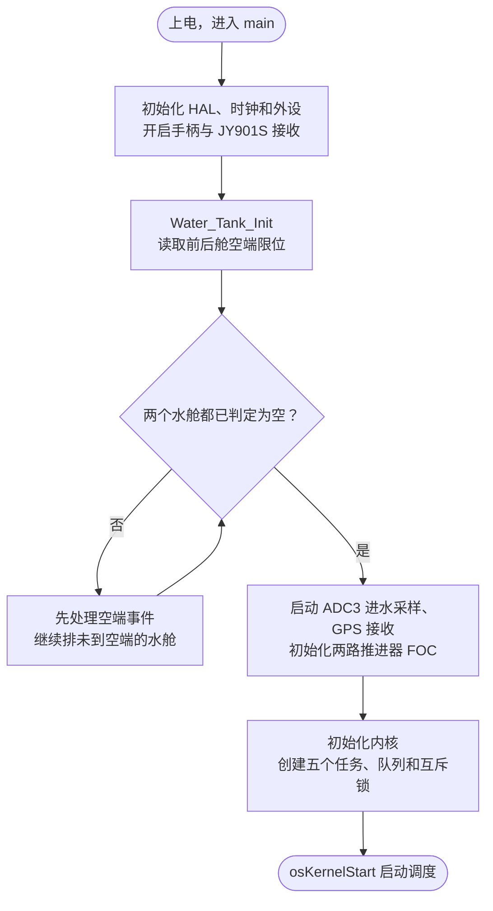
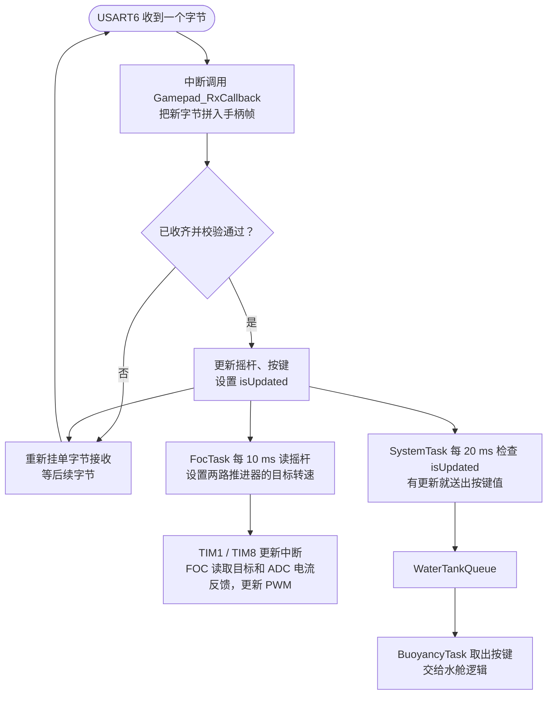
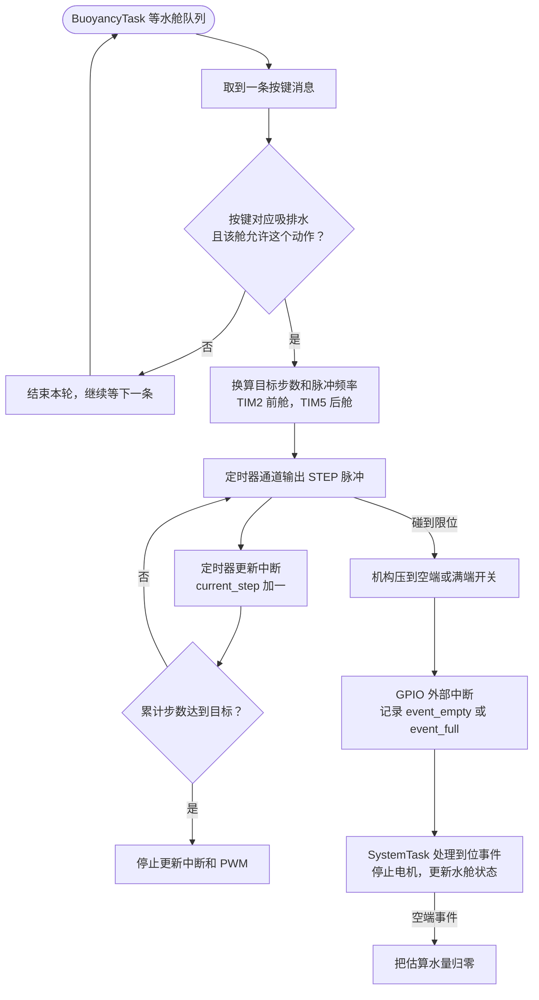
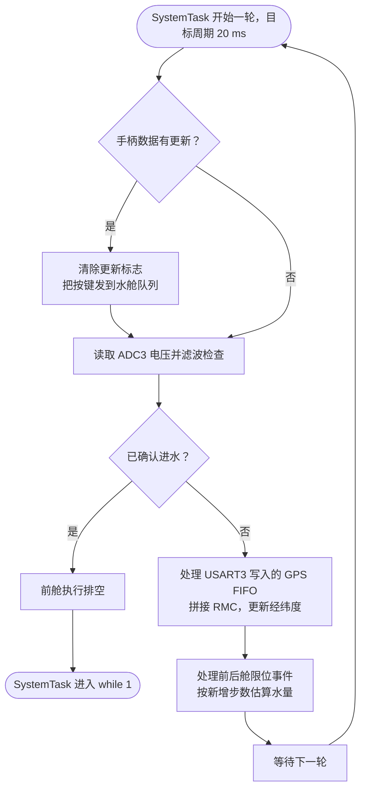

# STM32H723 水下机器人固件执行流程图

按此前核对的 `STM32H723ZGT6_ROV-RTOS` 版本绘制。方框表示操作，菱形表示判断，箭头表示下一步。任务周期是代码给出的目标节拍。

## 1. 上电，先归零再启动任务

如果一个舱迟迟没有被判定为空，程序会留在排空循环，五个业务任务要等 `osKernelStart()` 才开始执行。已开启的串口、步进定时器和限位中断在启动阶段也可以工作。

## 2. 手柄数据到达后，摇杆和按键各走哪条路

两条支路由不同的任务和中断按各自节拍执行。手柄串口是 **USART6，9600 波特、8N1**。原机无线链路按此前的方案理解为 D1 mini 转串口，实物接线仍待核对。

## 3. 按键控制水舱，什么情况会停

| 手柄按键 | 水舱指令 |
| --- | --- |
| A / B | 前舱进水 / 排水 **1 mL** |
| X / Y | 后舱进水 / 排水 **1 mL** |

默认频率约 **3200 脉冲/秒**。水舱正在动作、已经到该方向的限位等情况会拒绝新的动作。平时 `SystemTask` 根据新增步数估算水量。图里两条停机路径可能分别先到，取决于步数和实际机构位置。

## 4. SystemTask 一轮里，进水和正常运行怎么分支

水舱队列满时，该次发送立即返回失败，`SystemTask` 继续检查 ADC3。进水判断用两路检测电压，同一路滤波值连续 **10 次高于 0.5 V** 后确认。进入 `while (1)` 后，这个任务的 GPS 解析和日常水舱更新停止。其他高优先级任务依然由调度器调度。

## 5. 其他周期活动

| 入口或任务 | 节拍 | 这版代码做什么 |
| --- | --- | --- |
| SysTick | 1 ms | 更新 HAL 时基，调度器启动后也推进 FreeRTOS 的计时。 |
| TIM1 / TIM8 | 约 40 µs | 更新推进器的 FOC 控制。TIM1 触发 ADC2 并控制 2 号电机，TIM8 触发 ADC1 并控制 1 号电机。 |
| TIM3 | 每 10 ms 进中断 | 累计 10 次置调平标志。调平函数尚未接入当前任务。 |
| `NavigationTask` | 100 ms | 处理 USART1 和 DMA 收到的 JY901S 姿态数据。 |
| `CommTask` | 500 ms | 从 USART6 的 TX 发出当前 GPS 经纬度。 |

源码索引见同目录的 [固件读码总结](README.md)。
